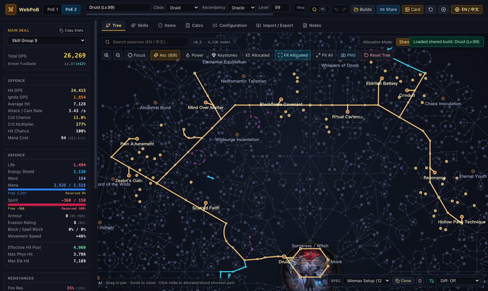

<div align="center">

# WebPoB

**Zero-install, open-source Path of Building viewer & planner in the browser for Path of Exile 1 & Path of Exile 2.**

[简体中文](./README.zh-CN.md) · **English**

[](https://webpob.pages.dev/?lang=en)
[](https://webpob.pages.dev/?lang=en&import=https://pobb.in/Xii_bN-QbdZn)
[](./LICENSE)
[-818cf8?style=for-the-badge)](#official-path-of-building-verification)

</div>

<p align="center">
  
</p>

## Try It Live

- **Main App (auto-detects browser language):** https://webpob.pages.dev/
- **Instant PoE 2 Demo (Lv.99 Druid Oracle CoC Comet, 12 Tree Specs):** https://webpob.pages.dev/?lang=en&import=https://pobb.in/Xii_bN-QbdZn
- **Share Any Build as a Clickable Link:** Append any `pobb.in` or `poe.ninja` build URL to `?import=` so friends or guide readers can inspect the passive tree, gear, gems, and DPS in one click — on mobile, Mac, or desktop:

```text
https://webpob.pages.dev/?import=https://pobb.in/YOUR_BUILD_ID
https://webpob.pages.dev/?lang=en&import=https://poe.ninja/poe2/pob/YOUR_ID
```

---

## Why WebPoB?

Built for players and guide creators who love Path of Exile's build freedom and want to **view, compare, and tweak PoB builds anywhere** — without installing a desktop client, signing in, or seeing ads.

| Capability | Highlights |
|---|---|
| **Dual-Game Support** | **Path of Exile 1 (`3.30`)** (2,750 passive nodes) & **Path of Exile 2 (`0.5`)** (4,524 passive nodes, all 8/8 classes) in a single shared ruleset architecture |
| **One-Click Build Import** | Direct `pobb.in` URLs, `poe.ninja` PoE 1 & PoE 2 URLs, raw PoB export codes (`Base64URL+zlib`), XML files, and GGG/Tencent character profile import |
| **60fps Canvas Passive Tree** | Smooth pan/zoom, mobile touch pinch-to-zoom, shortest-path allocation, PoE 2 **Weapon Set I / II** passives, Ascendancy sub-trees, visual Cluster Jewel sub-graphs, and Web Worker **Node Power Heatmap** |
| **Multi-Spec Tree Diff** | Switch between leveling and endgame tree specs with live **green (`+`) / red (`-`) diff highlighting** directly on the canvas |
| **Full Bilingual (EN / 中文)** | Auto-detects browser language (`?lang=en` / `?lang=zh` supported) with instant toggle across UI, passive nodes, gems, uniques, and **Ctrl+C in-game item parsing** |
| **Web-Native Tooling** | Pure client-side TypeScript engine, offline **PWA** + **IndexedDB** local build library, `#pob=` URL sharing, PNG/Markdown build card exporter, Command Palette (`Ctrl/Cmd+K`), and 40-step Undo/Redo |

<p align="center">
  
  <br />
  <sub>Multi-Spec Passive Tree Diff Overlay (green added / red removed nodes) with full Simplified Chinese & English support.</sub>
</p>

---

## Official Path of Building Verification

WebPoB's pure TypeScript calculation engine (`@webpob/calc`) is continuously regression-tested against **official upstream [PathOfBuilding](https://github.com/PathOfBuildingCommunity/PathOfBuilding) (PoE 1 `3.30`)** and **[PathOfBuilding-PoE2](https://github.com/PathOfBuildingCommunity/PathOfBuilding-PoE2) (PoE 2 `0.5`)** running headlessly in LuaJIT (`HeadlessWrapper.lua`):

- **131 Golden Oracle Benchmarks** (`fixtures/oracle/snapshots.json`) + **174/174 Vitest unit & codec tests** passing in CI.
- **`<= 0.5%` Hit DPS & Full DPS parity** across official benchmarks covering all **8/8 PoE 2 `0.5` classes**, PoE 2 Spirit / Weapon Set / Archmage / Multi-Support mechanics, and core PoE 1 `3.30` endgame mechanics (Conversions, Aura/Curse Effect, Charges, Rage, Enlighten, Impale, CoC, Traps/Mines, Minions, Full DPS, Guard Skills, Pantheon, Leech, Ward, Spell Suppression, Timeless & Cluster Jewels, and major Ascendancies).
- **Honest Scope:** WebPoB shines today as a fast zero-install viewer, mobile/Mac companion, multi-spec diff tool, and lightweight planner. Niche skill-specific desktop PoB interactions continue to be expanded — if a build imports strangely or a stat looks off, please open an issue with the `pobb.in` link!

---

## Monorepo Architecture

```text
WebPoB/
├── packages/
│   ├── core/        # @webpob/core  - Shared types, Build/Tree/Skill/Item/Mod/Calc schemas, GameRuleset
│   ├── i18n/        # @webpob/i18n  - EN/ZH-CN UI translations, game glossary, bilingual mod normalizer
│   ├── data/        # @webpob/data  - PoE 1 & PoE 2 rulesets, classes, passive trees, gems, items, presets
│   ├── codec/       # @webpob/codec - Official PoB Base64URL+zlib XML codec & EN/ZH item clipboard parser
│   └── calc/        # @webpob/calc  - Pure TS PoB calculation engine (ModDB, ModParser, Offence, Defence)
├── apps/
│   ├── web/         # @webpob/web   - React + Vite + Tailwind web app, 60fps Canvas Tree, Pages /api/proxy
│   └── cors-proxy/  # Optional standalone Cloudflare Worker CORS proxy with edge caching
├── fixtures/
│   └── oracle/      # Official LuaJIT PathOfBuilding Golden Snapshots (131 PoE 1 & PoE 2 benchmarks)
└── scripts/
    ├── sync-data/   # Upstream PathOfBuilding & PoeCharm bilingual sync + LuaJIT skill/base exporter
    └── oracle-diff/ # Automated differential verification harness against official PathOfBuilding LuaJIT
```

## Quick Start (Local Development)

```bash
# 1. Install dependencies (Node.js 20+ & pnpm)
pnpm install

# 2. Run local dev server
pnpm dev

# 3. Run unit tests, PoB Oracle regression suite & typecheck
pnpm test
pnpm typecheck

# 4. Production build
pnpm build

# 5. (Optional) Re-sync upstream trees / Lua skill & base tables / Oracle diff
pnpm sync:data
pnpm sync:lua
pnpm oracle:diff
```

### Self-Hosting / Deployment

WebPoB is static-first and deploys directly to **Cloudflare Pages** (with built-in edge-cached `/api/proxy` via `apps/web/functions/api/proxy.ts`):

```bash
pnpm build
cd apps/web && npx wrangler pages deploy dist --project-name webpob
```

---

## Development History

<details>
<summary><strong>Click to expand Full Development Changelog (Phases 1–20 + Performance & i18n Updates)</strong></summary>

- **Post-Phase 20 — Performance, Edge Caching & URL Import Polish**
  - Cloudflare `caches.default` edge caching on `/api/proxy` and standalone CORS Worker
  - Two-stage lazy official data loading (`tree + gems` critical path; `bases / uniques / clusters` deferred to idle/tab demand)
  - Eliminated double data download on `?import=` / `#pob=` direct links
  - Compressed PoE 2 ascendancy art (`bg-ring.webp` -74.5%, progressive JPEG portraits -48.9%), instant dark boot skeleton, immediate Service Worker v3
  - Added `poe.ninja/poe1/pob/` URL support, automatic browser locale detection (`navigator.language`), and `?lang=en` / `?lang=zh` URL override
- **Phase 20** — Hierophant / Occultist / Champion ascendancies, Equipped Gear Stat Totals Drawer, Smart Trade Search Builder (PoE 1 Intl/CN & PoE 2), Global Command Palette (`Ctrl/Cmd+K`) & Shortcuts Modal (`?`), 130+ Oracle benchmarks.
- **Phase 19** — PoE 1 Pantheon gods, realistic Life/ES Leech rates, flat PDR, Charge & Attribute stacking, Live Skills DPS Strip & 1-click gem presets, Allocated Passives Summary Drawer & per-point hover efficiency.
- **Phase 18** — Aura & Curse Effect scaling, full Elemental Conversion chain (`Phys → Light → Cold → Fire → Chaos`), Guard Skills (`Molten Shell` / `Steelskin` / `Arcane Cloak`), 6 Build Presets Gallery, PoB XML Inspector, color-coded PoB Notes editor, Defence Mitigation Dashboard.
- **Phase 17** — Side-by-side Item Compare & Affix Editor Modal, Tree Keystone/Socket Quick-Jump Drawer & Fit-Allocated framing, Juggernaut `Unbreakable` & Trickster `Escape Artist` / `Polymath`.
- **Phase 16** — Level & Main Gem Progression ROI curve (`Lv.18–30` / `Lv.60–100`), Berserker / Slayer / Necromancer ascendancies, `Iron Will` / `Iron Grip`, Chaos Penetration.
- **Phase 15** — Global 40-step Undo/Redo, Multi-Skill Sets (`<SkillSet>`), IndexedDB JSON backup/restore, Inquisitor `Inevitable Judgement` & `Righteous Providence`, `Eldritch Battery`, Enemy Blinded.
- **Phase 14** — Multi-Spec Passive Trees (`<Tree activeSpec="N">`) & Visual Canvas Diff Overlay, Multi-Item Sets (`<ItemSet>`), Purity Auras & Fortification, 100 Oracle benchmark milestone.
- **Phase 13** — Rage & Enlighten Reservation engine, `Tempest Shield` Spell Block, Smart Build Health Diagnostics, HiDPI Passive Tree PNG Snapshot exporter.
- **Phase 12** — Skill Gem Level/Quality & Empower/Enhance engine (`Ashes of the Stars`, `Arc` chain scaling), Quick Combat What-If Simulator, Vite route & vendor code splitting.
- **Phase 11** — Smart Unique Upgrade Advisor, responsive mobile layout & 2-finger pinch-to-zoom, Trap/Mine/Cooldown engine, 100% 8/8 PoE 2 class coverage.
- **Phase 10** — Multi-Skill `Full DPS` aggregation (`×Count`), authentic independent Ailment base damage, one-click PNG/Markdown Build Summary Card exporter.
- **Phase 9** — Web Worker Top Power Notables efficiency drawer, PoE 2 `Archmage` Spirit & `<WeaponSet1>/<WeaponSet2>` XML parity, Crit vs Non-Crit Armour mitigation.
- **Phase 8** — Smart Support Gem Optimizer, Interactive Rare Item Crafting Bench (`2,706` bases), Minion Combat Engine, Offline PWA support.
- **Phase 7** — Visual Cluster Jewel sub-graphs on canvas, Expedition Ward, Impale Support, CoC `0.033s` tick breakpoints, Timeless Jewel Keystones.
- **Phase 6** — 308 official Cluster Jewel Notables, Dual-Wielding, Endgame Combat Configs, Character Profile Importer, Side-by-Side Build Compare.
- **Phase 5** — 1,731 bilingual Uniques, authentic Local Weapon/Armour math, Curses & Marks, Interactive Tree Jewel Sockets, Trade Search helper.
- **Phase 4** — ES Module Web Worker Node Power Heatmap, IndexedDB Multi-Build Library, `#pob=` URL-hash sharing.
- **Phase 3** — LuaJIT Differential Oracle harness, 1,794 Lv.1–30 skill tables & 2,631+ bases, Ascendancy sub-trees, Active Flasks, MoM & Ailments.
- **Phase 2** — Official PoE 1 (`3.30`) & PoE 2 (`0.5`) tree/gem sync, ~99% PoeCharm Chinese dictionary merge, 60fps frustum-culled Canvas tree.
- **Phase 1** — Pure TS monorepo foundation (`ModDB`, `ModParser`, `CalcOffence`, `CalcDefence`, PoB codec, bilingual item parser, React UI).

</details>

## Contributing & License

Issues, bug reports (please attach the `pobb.in` link or PoB export code!), translation fixes, and PRs are all very welcome. See [CONTRIBUTING.md](./CONTRIBUTING.md) for guidelines.

Licensed under the [MIT License](./LICENSE). Inspired by and compatible with [PathOfBuildingCommunity/PathOfBuilding](https://github.com/PathOfBuildingCommunity/PathOfBuilding) and [PathOfBuilding-PoE2](https://github.com/PathOfBuildingCommunity/PathOfBuilding-PoE2).
